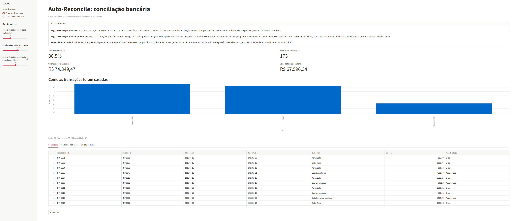

# auto-reconcile

[English](#english) · [Português](#português) · [Live demo](https://auto-reconcile-luisritton.streamlit.app/)



**Live demo:** https://auto-reconcile-luisritton.streamlit.app/ (on the free hosting plan, the app may take a few seconds to wake up on the first visit.)

---

# English

A Python tool that matches bank transactions with invoices and reports what does not match.

## Problem

Bank reconciliation means checking each bank statement line against the invoices or bills it pays. Done by hand, it is slow, and small differences in names, dates or amounts make it easy to miss a match or pair the wrong one.

## Solution

auto-reconcile reads a bank statement CSV and an invoices CSV, matches them with two rules, and writes the result as CSV files and an Excel workbook. Anything it cannot match is listed as pending, on both sides, so a person can review it.

## How it works

The two rules, side by side:

|                              | Exact rule                           | Approximate rule                                              |
|------------------------------|--------------------------------------|---------------------------------------------------------------|
| When it applies              | first, to all transactions           | only to transactions the exact rule did not match             |
| Amount                       | equal (to the cent)                  | equal (to the cent)                                           |
| Date                         | within 2 days of the invoice date    | within 30 days of the invoice date                            |
| Name similarity (normalized) | at least 0.6                         | at least 0.6                                                  |
| If several invoices qualify  | closest date, then lowest invoice id | highest similarity, then closest date, then lowest invoice id |

Names are normalized before comparison: lowercase, accents removed, dots, commas and hyphens removed, common bank words (`pix`, `ted`, `transf`, `pagto`) removed, and spaces collapsed. Similarity is the `difflib` ratio between the two normalized names.

Each invoice can be used at most once. Transactions are processed in `transaction_id` order. Neither rule matches on the bank description alone: the amount and the date window must also agree.

## Results

Results on **synthetic data**, with default parameters (exact window 2 days, approximate window 30 days, minimum similarity 0.6). The decoy cases were designed by the author. Source: [`results/evaluation.csv`](results/evaluation.csv), generated by `scripts/evaluate_matching.py`.

| Stage               | Matches | Correct | False matches | Precision | Coverage |
|---------------------|---------|---------|---------------|-----------|----------|
| Exact               | 83      | 83      | 0             | 1.0       | 0.4798   |
| Approximate (fuzzy) | 90      | 90      | 0             | 1.0       | 0.5202   |
| Overall             | 173     | 173     | 0             | 1.0       | 1.0      |

Expected matches: 173. Unmatched rows: 42, all of them rows with no expected invoice (decoys and extra transactions designed into the sample).

**Two different rates.** The dashboard shows a *conciliation rate* of 80.5%, which is matched bank transactions divided by all bank transactions (173 / 215). The evaluation table shows *coverage* of 1.0, which is correct matches divided by expected pairs (173 / 173). They measure different things: the 42 unmatched rows lower the conciliation rate but not the coverage, because none of them had an expected invoice.

Coverage per stage is the correct matches of that stage divided by all 173 expected pairs. The exact coverage (0.4798) and the approximate coverage (0.5202) add up to the overall coverage (1.0), so neither number is the success rate of its rule on its own.

**Generalization check.** Two new seeds (2024 and 7), with customer names and bank prefixes that the original generator does not use, run with the same default parameters. Source: [`results/validation.csv`](results/validation.csv).

| Run       | Expected | Correct | False matches | Precision | Coverage | Unmatched rows |
|-----------|----------|---------|---------------|-----------|----------|----------------|
| Seed 2024 | 173      | 173     | 0             | 1.0       | 1.0      | 42             |
| Seed 7    | 173      | 173     | 0             | 1.0       | 1.0      | 42             |

The expected count (173) and the unmatched count (42) are fixed by the generator's structure, so only the content changes between seeds. The exact/approximate split does change: 83/90 in the original sample and in seed 2024, and 80/93 in seed 7.

**Similarity margin.** Among correctly matched pairs, the lowest name similarity was 0.7143 (exact) and 0.6857 (approximate) in the original sample, and 0.64 in both validation seeds. Source: [`results/similarity_validation.csv`](results/similarity_validation.csv).

## How to run

```
pip install -r requirements.txt

# Generate the synthetic sample files (optional; they are already in data/sample)
python src/reconcile/generate_sample.py

# Run the tests
python -m pytest

# Evaluate the matcher on the sample and save output/evaluation.csv
python scripts/evaluate_matching.py

# Run the dashboard
streamlit run app.py
```

On Windows, use `python scripts\evaluate_matching.py` in the same way.

## Limitations

- **The data is synthetic.** The author generated it, and the decoy cases were designed by the author. The results measure the pipeline on controlled cases, not on real bank data.
- **The name threshold has a small margin.** The lowest similarity of a correct pair was 0.64, just above the 0.6 threshold. Bank descriptions with reference codes or heavier abbreviations may fall below it and go to manual review. The threshold should not be raised to add margin, because that would remove correct matches.
- **The original sample is not an independent test.** The normalization rules and the 30-day window were adjusted after diagnostics on that sample. Only the two validation seeds were generated afterwards, and they use the same generator.
- **The 30-day approximate window** is a parameter chosen to match common payment delays, not a value optimized on real data. In the sweep, a 45-day window produced false matches.
- **Matching depends only on normalized name text.** It does not know the description format of any specific bank.
- **Matching is one-to-one.** One transaction matches at most one invoice, and each invoice is used once. Partial payments, split payments, multiple currencies and one-to-many matches are not supported.
- **Input must be CSV** with the expected columns. Other formats are not supported.
- Matches that the rules cannot make are sent for manual review. The tool does not guess.

## Project context

Portfolio project, built in phases: matching rules and tests, reports (CSV and Excel), a Streamlit dashboard, and an evaluation on synthetic data. The code was written with AI assistance (vibecoding); the author reviewed, tested and explained each phase as a learning exercise. It has not been used with real financial records.

## Development tools

Three scripts in `scripts/` were used during development to find and measure errors. They are not needed to run the tool.

- `scripts/diagnose_misses.py`: lists each expected pair the matcher missed, gives the first reason it was missed, counts false matches by decoy type, and sweeps the approximate window.
- `scripts/validate_generalization.py`: generates new synthetic data with other seeds and other names, then measures the matcher on it.
- `scripts/measure_similarity.py`: prints the name similarity distribution of correct matches, by stage, for each dataset.

---

# Português

Ferramenta em Python que cruza lançamentos do extrato bancário com faturas e aponta o que não bate.

## Problema

A conciliação bancária consiste em conferir cada linha do extrato com as faturas ou cobranças que ela paga. Feita à mão, é lenta, e pequenas diferenças de nome, data ou valor tornam fácil deixar um par de fora ou associar o par errado.

## Solução

O auto-reconcile lê um CSV de extrato bancário e um CSV de faturas, faz o cruzamento com duas regras e gera o resultado em arquivos CSV e em uma planilha Excel. O que não consegue casar fica listado como pendente, dos dois lados, para uma pessoa revisar.

## Como funciona

As duas regras, lado a lado:

|                                  | Regra exata                                          | Regra aproximada                                                                 |
|----------------------------------|------------------------------------------------------|----------------------------------------------------------------------------------|
| Quando se aplica                 | primeiro, a todos os lançamentos                     | só a lançamentos que a regra exata não casou                                     |
| Valor                            | igual (até o centavo)                                | igual (até o centavo)                                                            |
| Data                             | a no máximo 2 dias da data da fatura                 | a no máximo 30 dias da data da fatura                                            |
| Similaridade do nome normalizado | pelo menos 0,6                                       | pelo menos 0,6                                                                   |
| Se mais de uma fatura servir     | a de data mais próxima; em empate, a de menor número | a de maior similaridade; depois a de data mais próxima; depois a de menor número |

Os nomes são normalizados antes da comparação: tudo em minúsculas, acentos removidos, pontos, vírgulas e hifens removidos, palavras comuns de banco (`pix`, `ted`, `transf`, `pagto`) removidas e espaços repetidos reduzidos a um. A similaridade é a razão do `difflib` entre os dois nomes normalizados.

Cada fatura pode ser usada no máximo uma vez. Os lançamentos são processados em ordem de `transaction_id`. Nenhuma das regras casa apenas pela descrição do banco: valor e janela de datas também precisam bater.

## Resultados

Resultados com **dados sintéticos**, com os parâmetros padrão (janela exata de 2 dias, janela aproximada de 30 dias, similaridade mínima de 0,6). Os casos de decoy foram desenhados pelo autor. Fonte: [`results/evaluation.csv`](results/evaluation.csv), gerado por `scripts/evaluate_matching.py`.

| Etapa              | Casamentos | Corretos | Falsos casamentos | Precisão | Cobertura |
|--------------------|------------|----------|-------------------|----------|-----------|
| Exata              | 83         | 83       | 0                 | 1,0      | 0,4798    |
| Aproximada (fuzzy) | 90         | 90       | 0                 | 1,0      | 0,5202    |
| Geral              | 173        | 173      | 0                 | 1,0      | 1,0       |

Casamentos esperados: 173. Linhas não conciliadas: 42, todas sem fatura esperada (decoys e lançamentos extras desenhados no exemplo).

**Duas taxas diferentes.** O painel mostra uma *taxa de conciliação* de 80,5%, que é o número de lançamentos conciliados dividido pelo total de lançamentos do banco (173 / 215). A tabela de avaliação mostra *cobertura* de 1,0, que é o número de casamentos corretos dividido pelos pares esperados (173 / 173). Eles medem coisas diferentes: as 42 linhas não conciliadas reduzem a taxa de conciliação, mas não a cobertura, porque nenhuma delas tinha fatura esperada.

A cobertura por etapa é o número de casamentos corretos daquela etapa dividido pelos 173 pares esperados. A cobertura exata (0,4798) e a aproximada (0,5202) somam a cobertura geral (1,0), então nenhum desses números é, sozinho, a taxa de acerto da sua regra.

**Verificação de generalização.** Duas novas seeds (2024 e 7), com nomes de clientes e prefixos bancários que o gerador original não usa, com os mesmos parâmetros padrão. Fonte: [`results/validation.csv`](results/validation.csv).

| Execução  | Esperados | Corretos | Falsos casamentos | Precisão | Cobertura | Linhas não conciliadas |
|-----------|-----------|----------|-------------------|----------|-----------|------------------------|
| Seed 2024 | 173       | 173      | 0                 | 1,0      | 1,0       | 42                     |
| Seed 7    | 173       | 173      | 0                 | 1,0      | 1,0       | 42                     |

O número de esperados (173) e o de não conciliados (42) são fixos pela estrutura do gerador, então só o conteúdo muda entre as seeds. A divisão entre exatas e aproximadas muda: 83/90 no exemplo original e na seed 2024, e 80/93 na seed 7.

**Margem da similaridade.** Entre os pares corretos, a menor similaridade de nome foi 0,7143 (exata) e 0,6857 (aproximada) no exemplo original, e 0,64 nas duas seeds de validação. Fonte: [`results/similarity_validation.csv`](results/similarity_validation.csv).

## Como rodar

```
pip install -r requirements.txt

# Gerar os arquivos de exemplo (opcional; eles já estão em data/sample)
python src/reconcile/generate_sample.py

# Rodar os testes
python -m pytest

# Avaliar o matcher no exemplo e salvar output/evaluation.csv
python scripts/evaluate_matching.py

# Abrir o painel
streamlit run app.py
```

No Windows, use `python scripts\evaluate_matching.py` do mesmo jeito.

## Limitações

- **Os dados são sintéticos.** O autor gerou os dados, e os casos de decoy foram desenhados pelo autor. Os resultados medem o pipeline em casos controlados, não em extratos bancários reais.
- **A margem do limiar de nome é pequena.** A menor similaridade de um par correto foi 0,64, logo acima do limiar de 0,6. Descrições de banco com códigos de referência ou abreviações mais carregadas podem ficar abaixo dele e ir para revisão manual. O limiar não deve ser aumentado para ganhar margem, porque isso removeria casamentos corretos.
- **O exemplo original não é um teste independente.** As regras de normalização e a janela de 30 dias foram ajustadas depois do diagnóstico feito sobre esse exemplo. Só as duas seeds de validação foram geradas depois, e elas usam o mesmo gerador.
- **A janela aproximada de 30 dias** é um parâmetro escolhido para cobrir prazos de pagamento comuns, não um valor otimizado em dados reais. Na varredura, uma janela de 45 dias gerou falsos casamentos.
- **O casamento usa apenas o texto normalizado do nome.** Não conhece o formato de descrição de nenhum banco específico.
- **O casamento é um para um.** Um lançamento casa no máximo com uma fatura, e cada fatura é usada uma vez. Não há suporte a pagamentos parciais, pagamentos divididos, múltiplas moedas nem casamentos de um para muitos.
- **A entrada precisa ser CSV** com as colunas esperadas. Outros formatos não são suportados.
- Os casos que as regras não conseguem casar vão para revisão manual. A ferramenta não chuta.

## Contexto do projeto

Projeto de portfólio, feito por fases: regras de casamento e testes, relatórios (CSV e Excel), um painel em Streamlit e uma avaliação com dados sintéticos. O código foi escrito com apoio de IA (vibecoding); o autor revisou, testou e explicou cada fase, como exercício de aprendizado. Ainda não foi usado com registros financeiros reais.

## Ferramentas de desenvolvimento

Três scripts em `scripts/` foram usados durante o desenvolvimento para encontrar e medir erros. Eles não são necessários para rodar a ferramenta.

- `scripts/diagnose_misses.py`: lista cada par esperado que o matcher deixou de fora, dá o primeiro motivo, conta os falsos casamentos por tipo de decoy e varre a janela aproximada.
- `scripts/validate_generalization.py`: gera dados sintéticos novos, com outras seeds e outros nomes, e mede o matcher neles.
- `scripts/measure_similarity.py`: mostra a distribuição de similaridade de nomes dos casamentos corretos, por etapa, em cada conjunto de dados.